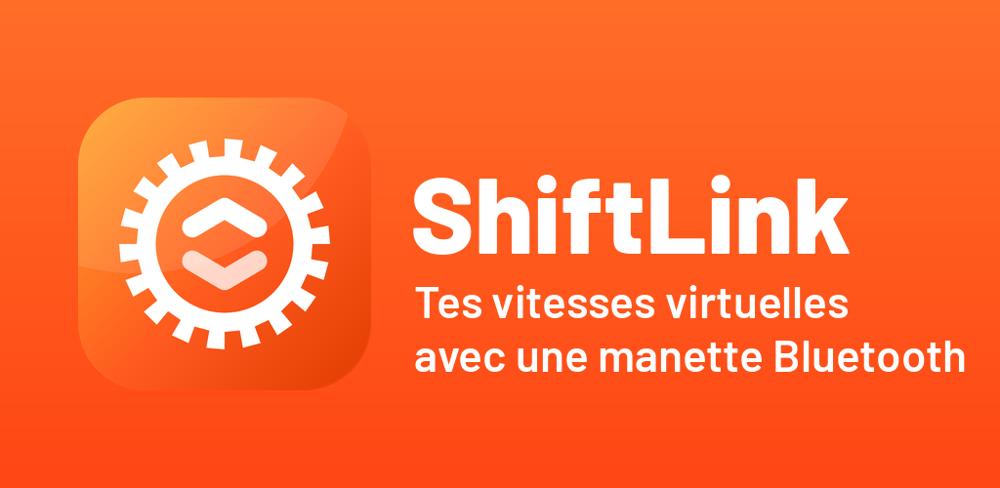
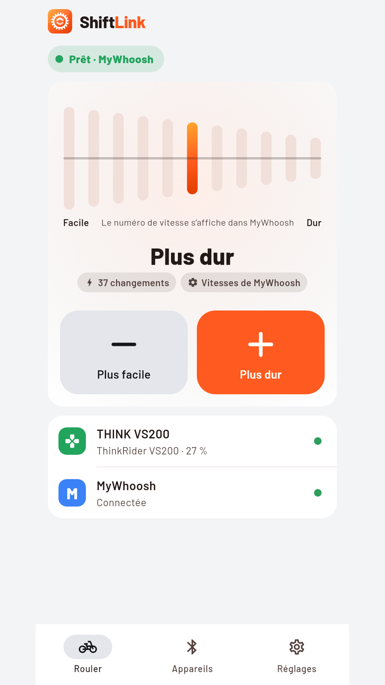
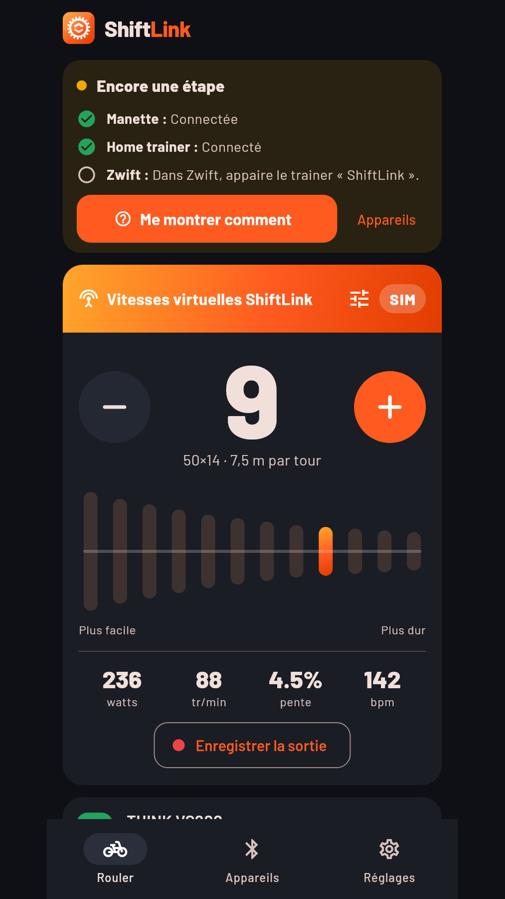
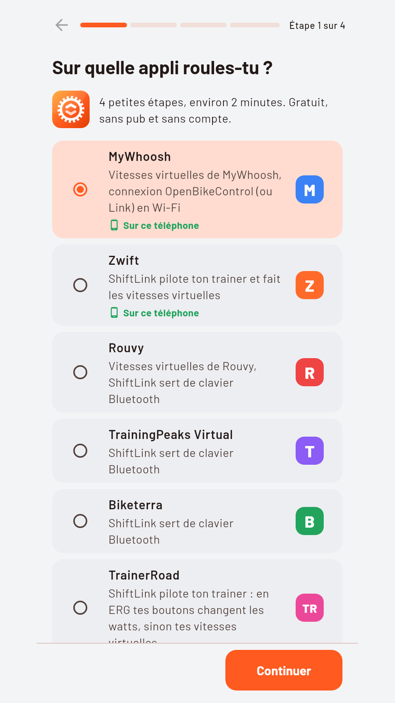
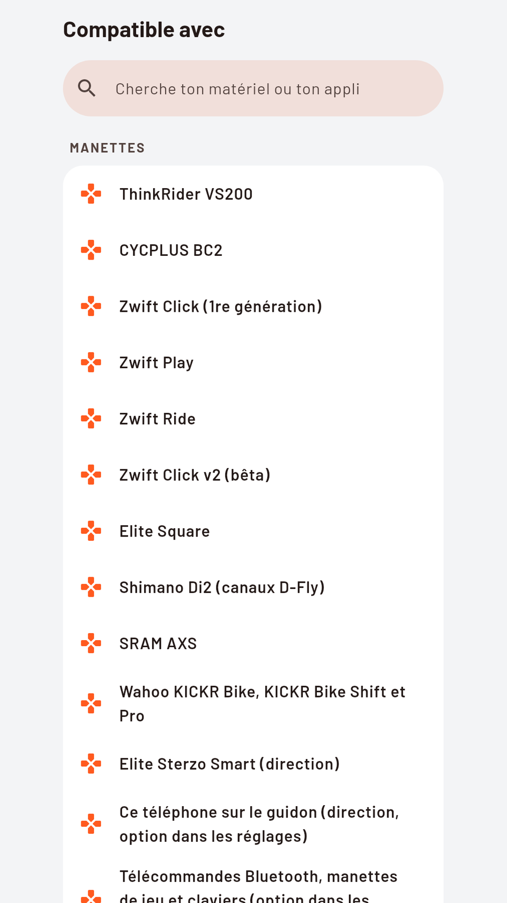
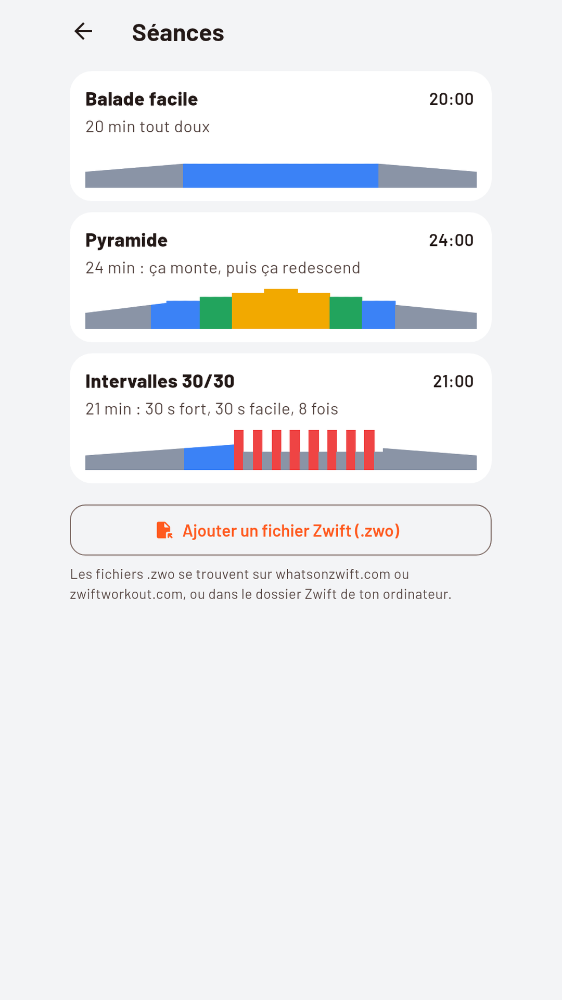
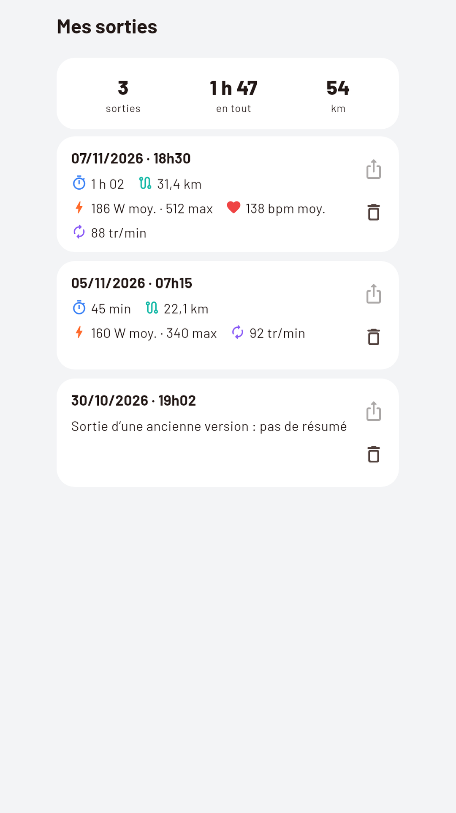
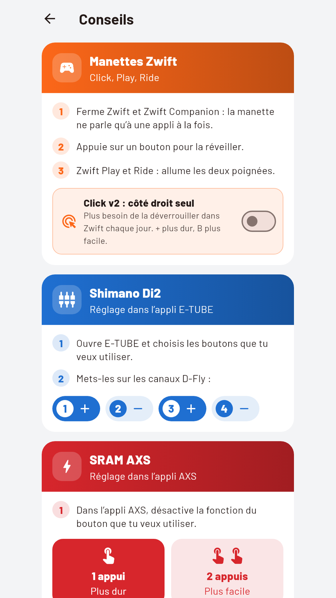

<p align="center">
  
</p>

<h1 align="center">ShiftLink</h1>

<p align="center">
  <b>Shift the virtual gears of your training app with any Bluetooth controller, on any smart trainer.</b><br>
  MyWhoosh · Rouvy · TrainingPeaks Virtual · Biketerra · Zwift · OpenBikeControl
</p>

<p align="center">
  <a href="../../releases/latest"></a>
  
  
  
</p>

---

## At a glance

- **Works with your controllers**: Zwift Click / Play / Ride, Elite Sterzo and Rizer, Shimano Di2, SRAM AXS, Wahoo KICKR Bike, CYCPLUS, ThinkRider, Bluetooth remotes, gamepads, volume keys…
- **Works with your apps**: MyWhoosh (Link), Rouvy, TPV, Biketerra and any app with keyboard shortcuts (your phone becomes a Bluetooth keyboard), OpenBikeControl over Wi-Fi.
- **Virtual gears for Zwift and trainers without shifting**: ShiftLink sits between the trainer and the app (Bluetooth FTMS or Wi-Fi DIRCON), with drivetrains from 1 to 30 gears and named profiles.
- **Training**: structured workouts (import .erg, .mrc, .fit, .zwo), ERG mode, ride recording to .fit, upload to Garmin Connect and Intervals.icu, heart-rate strap, KICKR Headwind fan.
- **Simple**: setup wizard, "Not working?" diagnostics, 9 languages (EN, FR, DE, ES, IT, PL, NL, PT, ZH), no account, no tracking.

## Screenshots

<p align="center">
  
  
  
  
</p>
<p align="center">
  
  
  
</p>

## How it works

The smart trainer stays connected directly to the app, which handles resistance and
virtual gears. ShiftLink reads the controller's buttons and sends "gear + / −" to the app:

| App | How |
|---|---|
| MyWhoosh | "Link" connection (local Wi-Fi, TCP 21587, same protocol as the MyWhoosh Link app) |
| Rouvy | Bluetooth keyboard: `.` and `,` (enable "Virtual Shifting Controls") |
| TrainingPeaks Virtual | Bluetooth keyboard: numpad `+` and `−` |
| Biketerra | Bluetooth keyboard: `W` and `S` |
| Other apps with keyboard shortcuts | Bluetooth keyboard, custom keys |
| OpenBikeControl-compatible apps | Open protocol, automatic discovery on Wi-Fi (TCP 36867) |
| Zwift and apps without virtual shifting | "ShiftLink virtual gears" mode (see below) |

In keyboard mode, the phone presents itself as a Bluetooth keyboard (HID profile,
Android 9 or later) to the computer or tablet running the app.

## Installing the APK

ShiftLink is not on the Play Store: download the APK from this repository's
**Releases** page.

1. On your Android phone (8 or later), open the latest release and tap
   `ShiftLink-x.y.z.apk` to download it.
2. Open the downloaded file. If Android asks, allow your browser (or file
   manager) to **install unknown apps**, then tap **Install**.
3. If Play Protect shows "Unrecognized app", tap **More details > Install
   anyway**. This is normal for an app outside the Play Store.
4. Launch ShiftLink: the setup wizard guides you through the rest.

### Allow restricted settings (Android 13 and later)

To tap the screen for you, or read Bluetooth remotes and volume keys, ShiftLink
uses an **accessibility service**. For apps installed outside the Play Store,
Android greys this service out and shows "Restricted setting". To unlock it,
once:

1. Try to enable ShiftLink in **Settings > Accessibility > Installed apps**:
   Android refuses and shows "Restricted setting". This attempt is what unlocks
   the next step.
2. Go to **Settings > Apps > ShiftLink**.
3. Tap the **⋮** menu in the top right, then **Allow restricted settings**, and
   confirm with your PIN or fingerprint.
4. Go back to **Settings > Accessibility > ShiftLink** and enable the service.

ShiftLink guides you through this from the setup wizard and from Settings > Not
working? The accessibility service is only needed for on-screen taps and
remotes: Bluetooth controllers, Bluetooth keyboard, MyWhoosh Link and
OpenBikeControl work without it.

Menu names vary a little by brand (Samsung, Xiaomi…). If the ⋮ menu does not
appear, repeat step 1 and try again.

### Updating

Download the new APK and install it over the old one: your settings are kept.
All release APKs are signed with the same key. A build compiled by someone else
will not install over it (you would have to uninstall first, which erases your
settings; make a backup first in Settings > Backup and sharing).

### Verifying the file (optional)

Each release lists the APK's SHA-256 fingerprint. On a computer:
`sha256sum ShiftLink-x.y.z.apk` (Linux/macOS) or
`certutil -hashfile ShiftLink-x.y.z.apk SHA256` (Windows).

## ShiftLink virtual gears (Zwift…)

ShiftLink connects to the smart trainer itself (FTMS, Bluetooth) and presents
itself to the app as a Wi-Fi trainer (Wahoo Direct Connect protocol, TCP 36866,
mDNS `_wahoo-fitness-tnp._tcp`). When the app requests a grade, ShiftLink adjusts
it for the selected gear before sending it to the trainer:

- grade + rolling resistance multiplied by the gear ratio k;
- aerodynamic coefficient multiplied by k³, wind divided by k.

24 gears, from ratio ×0.5 to ×2. In ERG mode, power passes through unchanged and
gears have no effect.

## Supported controllers

| Controller | Notes |
|---|---|
| ThinkRider VS200 | |
| CYCPLUS BC2 | |
| Zwift Click (1st generation) | |
| Zwift Click v2 | "Click v2: right side only" setting: nothing to do in Zwift (+ = harder, B = easier). Otherwise, connect it to the Zwift app for 30 s each day to get both sides |
| Zwift Play (firmware 2) | Each handle connects on its own (beta) |
| Zwift Play | Left = gear −, right = gear + (side button or paddle) |
| Zwift Ride and Ride V2 | Connects to the left handle, which relays the right one. Ride V2 (firmware 1.3+) must be unlocked in the Zwift app: ShiftLink tells you when it is locked |
| WHEELTOP EDS (OX, TX) | Beta. Rear derailleur off. Switch on R = gears, on T = two extra buttons |
| Elite Square | Left and right shift levers |
| Shimano Di2 | Buttons set to D-Fly channels in E-TUBE: channels 1/3 = +, 2/4 = − |
| SRAM AXS | Single press = +, double press = − |
| Wahoo KICKR Bike, Bike Shift, Bike Pro | Right buttons = +, left = − |
| Tacx NEO Bike (Smart, Plus) | Beta. Firmware 4.5+. Each shift on the levers = + or −, left / right buttons = steer. Also pair the bike as a trainer |
| Elite Sterzo Smart | Steering: turning the handlebar steers the rider (hold left / right) |
| Elite Rizer | Beta. Steering like the Sterzo, and the front of the bike follows the app's grade; the reported grade is shown, a refusal is logged |
| Wahoo KICKR Climb | Beta, in Devices > Accessories: the front of the bike follows the app's grade (−10 to +19 %) |
| This phone on the handlebar | Settings > Steer with this phone. Works in any phone position |

Without a controller, the large on-screen + and − buttons work too.

## Usage

On first launch, a 6-step wizard guides setup: choice of app, permissions,
controller search and test, connection to the app. It can be run again from
Settings.

During a ride, the main screen shows whether everything is ready, the current
gear (Zwift / proxy mode) or the last shift, and the status of each device.

For MyWhoosh: the phone and the MyWhoosh device must be on the same Wi-Fi (no
guest network or client isolation), and the "MyWhoosh Link" app must be closed
(it uses the same port). In MyWhoosh, choose the "Link" connection.

ShiftLink can run on the same device as the app: a "ShiftLink is active"
notification keeps it alive in the background.

Screenshots and icons: `flutter test test_screens --update-goldens` (in `test_screens/out`).

## Customizable buttons

Devices > (your controller): each button can trigger a different action on
single press, double press and long press (gears, steering, U-turn, camera, ERG
intensity, music, volume, Android back…). The available actions depend on the
chosen app. Settings are saved per app. A live banner shows the button pressed
and the action triggered.

Combos: two buttons pressed together trigger their own action (for example + and
− together to change chainring). Double-press and long-press timings are set in
the same place.

On the same phone, ShiftLink taps the app's on-screen buttons: default positions
for Rouvy, TPV and MyWhoosh, adjustable per action, with "Show targets" to check.

## Adjustable virtual gears (Zwift mode / ShiftLink trainer)

Settings > Virtual gears (or the settings icon on the gear card): drivetrain (24
even gears, road 2×12 and 2×11, gravel 1×12, MTB 1×12), chainrings, double
chainring with the "Change chainring" action, real gear engaged on the trainer,
grade effect, weight, grade smoothing, ERG intensity step ("Intensity + / −"
actions), vibration and sound on each shift.

Since 1.9:
- custom drivetrain: 1 to 30 gears, each ratio adjustable by touch (0.05 steps);
- named profiles ("Mountain", "Sprint"…), picked up automatically with the same trainer;
- trainer control: grade, target power (watts computed for the speed at your
  cadence) or plain resistance; "Auto" picks based on what the trainer supports;
- cadence filter, "simple relay" mode without gears;
- the app can connect over Wi-Fi (DIRCON) or Bluetooth (ShiftLink presents itself
  as an FTMS trainer);
- "MyWhoosh with ShiftLink gears" instead of MyShift.

Tested on 6 November 2026: ThinkRider VS200 + MyWhoosh over OpenBikeControl works.

MyWhoosh (normal mode) connects over OpenBikeControl (handlebar icon on the
connections screen) or, on older versions, over Link.

## Remotes, overlay, diagnostics

- Settings > Remotes: Bluetooth remotes, gamepads and keyboards paired with the
  phone act as controllers (by default, volume / D-pad up-down = gears). Their
  keys go through the accessibility service.
- Overlay on top of the app: a small movable window (gear, watts, cadence, ERG or
  last action).
- Settings > Not working?: checks Bluetooth, permissions, controller, Wi-Fi,
  trainer, app and background, and offers the fix.
- Language: English, French, German, Spanish, Italian, Polish, Dutch, Portuguese
  or Chinese (Settings > Display > Language; "Auto" follows the phone). Each
  language has its own file `lib/src/i18n_xx.dart`, with the French text as the
  key. The log stays in French.
- Accessibility: the gear is announced by the screen reader on each change, and
  screens are checked with text enlarged to 160 %.

## Sensors and outputs (2.x)

- Bluetooth heart-rate strap: heart rate is shown, recorded and sent to the app
  when ShiftLink handles the gears.
- Wahoo KICKR Headwind fan (beta): manual ("Fan + / −" actions), or driven by
  your speed, power or heart rate (the fan's own strap, or the one paired with
  ShiftLink), with a "starts at / full at" setting.
- Ride recording: .fit file (power, cadence, speed, heart rate, distance) to send
  to Strava, Garmin Connect or intervals.icu.
- Connected apps (Settings > Automatic > Connected apps): Garmin Connect and
  Intervals.icu (API key). Strava is connected in MyWhoosh. Garmin Connect: each
  recorded ride is uploaded automatically, and a .fit from MyWhoosh can be sent
  manually. The file is repaired first: power, heart-rate and cadence averages
  added, temperature removed. The login reuses the Garmin Connect mobile app's
  flow, like [python-garminconnect](https://github.com/cyberjunky/python-garminconnect)
  (MIT): Garmin's login page inside the app, ticket exchanged for a token kept on
  the phone. This is not an official API: Garmin may change it.
- MyWhoosh account (same page): ShiftLink fetches your rides and their original
  .fit from MyWhoosh, then uploads new ones to Garmin Connect when the app opens
  (older ones manually from "My MyWhoosh rides"). The password is only used to
  log in; only the session is kept on the phone. Private, unofficial MyWhoosh
  app API: it may change.
- Settings > Backup and sharing: file, QR code or text to copy, no account
  needed. Paired devices stay on the phone.

## What's new in 2.3

- Trainers: besides FTMS, older Tacx and other Bluetooth **FE-C** trainers
  (commands translated to ANT+ FE-C pages) and **Wi-Fi** trainers (DIRCON client,
  `_wahoo-fitness-tnp._tcp` discovery).
- **Cadence** (CSC) and **power** (Cycling Power) sensors: cadence drives the
  gears, and the sensor's watts can replace the trainer's towards the app.
- **Resistance test** (10 s easy, 10 s hard) in the trainer connection.
- **ERG without an app** (starts at the last target or your power) and **staircase workout**.
- Controllers: "Not mine" (device ignored forever), **sleep** 5 min after the end
  of a ride, **gamepad vibration** on each shift.
- **Automatic ride recording**, export to **Health Connect**, `app.shiftlink.ACTION`
  intent for Tasker / MacroDroid (extras: action, button, gesture, device).
- Android 8 minimum (Health Connect).

## What's new in 2.7 (ideas taken from QZ / qdomyos-zwift)

- **Riders**: one profile per person (first name, weight, FTP, max heart rate,
  optional gear profile), picked with one tap at the top of the Ride screen.
  Weight drives the virtual gears.
- **Workouts without an app**: the trainer follows a workout in ERG (watts = % of
  the rider's FTP). Three built-in workouts (easy ride, pyramid, 30/30) and import
  of Zwift **.zwo** files (SteadyState, Warmup, Cooldown, Ramp, IntervalsT,
  FreeRide, MaxEffort). The timer pauses when you stop pedalling; Intensity ±
  buttons stay active; an app taking control stops the workout.
- **Heart-rate zones** (60/70/80/90 % of max HR) in colour during the ride.
- **Estimated watts** from speed and weight when the trainer sends no power (also
  sent to the app).
- **Displayed metrics** of your choice (watts, cadence, grade/target, heart rate,
  speed; up to 4).
- Apps that handle their own gears: the cassette draws **one cog per app gear**
  (MyWhoosh 30, Zwift/Rouvy and others 24; adjustable with one tap).
- Phone steering: zero is taken after 1.5 s even if the handlebar vibrates;
  message if the phone has no gyroscope; the "Phone on handlebar" card no longer
  jumps to the top of the list.

## What's new in 2.10

- **Map and elevation in the .fit**: a ride on a GPX route keeps its position and
  altitude ("virtual" ride), so Strava and Intervals.icu show the map and climbing.
- **Resume a route** where you stopped, or start from any km. The record (ghost)
  only counts for a route ridden from the start.
- **One lap per workout block** in the .fit (average watts, heart rate and cadence
  for each interval).
- **.zwo files**: requested cadence (`Cadence`, `CadenceResting`) and messages
  (`textevent`) are shown during the workout and read aloud.
- Trainer **calibration (spin down)**, for FTMS trainers that support it.
- **Up to 200 routes** (one file each in the app folder, no longer in
  preferences), and GPX files up to 4 MB are accepted. Routes are not part of the
  settings backup.

## Security

- Network servers (OpenBikeControl, Link, Wi-Fi trainer) only accept devices on
  the local network, never an Internet address.
- The Bluetooth trainer accepts only one app at a time and rejects malformed
  commands. Requested power is capped at 2000 W.
- The Sterzo code file is verified by its SHA-256 fingerprint.
- No account, no tracking, no cloud backup of settings, no plain-text HTTP traffic.

## Building

```
flutter test
flutter build apk --release
```

To sign with the ShiftLink key (required for updates to install over the
previous version), add `android/key.properties`:

```
storePassword=…
keyPassword=…
keyAlias=shiftlink
storeFile=/path/to/shiftlink.jks
```

## License and sources

ShiftLink is released under GPL-3.0 (see `LICENSE`). Its code is written for
ShiftLink.

Device protocols (Bluetooth identifiers, frame layouts, network messages) are
facts imposed by the hardware and apps: ShiftLink applies them as-is so things
work. Public sources used:

- Zwift Click and Play: [ajchellew/zwiftplay](https://github.com/ajchellew/zwiftplay);
  Zwift Ride and Click v2: [Makinolo, "Zwift Ride protocol"](https://www.makinolo.com/blog/2024/07/26/zwift-ride-protocol/);
- Zwift Ride V2, WHEELTOP EDS, Elite Rizer, CYCPLUS T7, Tacx NEO Bike: public
  protocol descriptions by [OpenBikeControl](https://github.com/OpenBikeControl/bikecontrol)
  (protocol facts only, no code reused);
- KICKR Climb: sniffer capture by [Redback Operations](https://github.com/Redback-Operations/redback-smartbike-iot) (GPL-3.0);
- Elite Sterzo: [pycycling](https://github.com/zacharyedwardbull/pycycling) (MIT),
  whose response-code file is downloaded on first use;
- OpenBikeControl: [openbikecontrol.org](https://openbikecontrol.org), open protocol;
- keyboard shortcuts: the apps' help pages (Rouvy, Zwift…);
- other devices (ThinkRider, CYCPLUS, Elite Square, Shimano Di2, SRAM AXS, Wahoo
  KICKR Bike, Headwind, MyWhoosh Link): publicly known identifiers and frame
  formats, applied in code written for ShiftLink.

ShiftLink is an independent project. It is not affiliated with MyWhoosh, Zwift,
BikeControl / OpenBikeControl, or the controller manufacturers.
